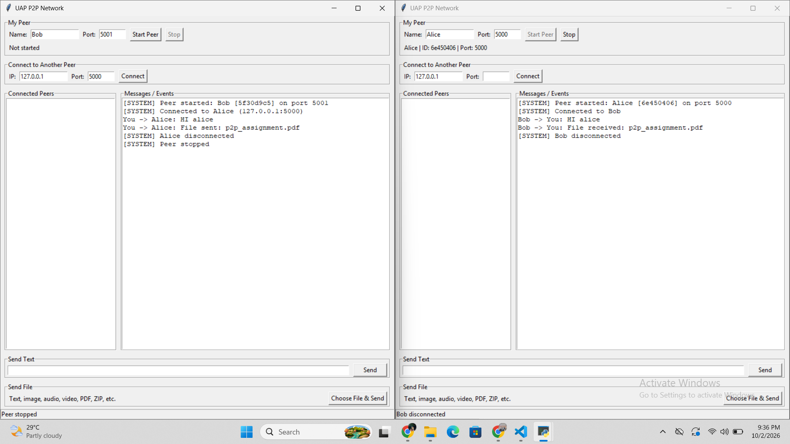

# P2P Network

## 1. Project Description

A lightweight peer-to-peer network built with Python TCP sockets. Computers on the
same network connect to each other **directly** and exchange text messages and files,
with no central server in the middle.

Each running copy of `main.py` is one **peer** in the network. Every peer plays two roles at the same time:

| Role   | What it does                               | Socket calls                  |
|--------|--------------------------------------------|-------------------------------|
| Server | waits for other peers to reach it          | `bind` → `listen` → `accept`  |
| Client | reaches out to another peer by IP and port | `connect`                     |

Once two peers are linked, either side can send:

- a **text message**, or
- **any file** – photo, song, video, PDF, ZIP, anything. The file is shipped as raw bytes,
  so one routine covers every file type.

The network also:

- gives every peer a short ID (e.g. `5f30d9c5`) and exchanges names and IDs with a
  `hello` / `hello_ack` handshake
- keeps a list of everyone you are linked with
- handles many peers at once, each one served by its own thread
- shows clear error messages instead of crashing (wrong port, refused connection,
  peer left, no peer selected …)

Every message is sent as `[4-byte length][JSON]`, so the receiver always knows
where one message ends and the next begins.

### Files

| File / folder      | Job |
|--------------------|-----|
| `main.py`          | the window: inputs, buttons, peer list, message log, status bar |
| `p2p_node.py`      | networking: server, client, handshake, text, file transfer |
| `protocol.py`      | message framing (`[4-byte length][JSON]`) |
| `requirements.txt` | nothing to install |
| `downloads/`       | received files are saved here |
| `screenshots/`     | pictures used in this README |

---

## 2. Requirements

- **Python 3.9 or later** (Windows, Linux or macOS)
- No third-party packages. Only Python's built-in modules are used:
  `socket` · `threading` · `json` · `struct` · `os` · `uuid` · `queue` · `tkinter`
- For a two-computer test: both machines on the **same Wi-Fi or LAN**

---

## 3. Installation / Setup Instructions

1. Install Python from python.org. On Windows, tick **Add Python to PATH**.
2. Check that Python and Tkinter work:
   ```
   python --version
   python -m tkinter
   ```
   The second command opens a small test window.
   On Linux, if Tkinter is missing: `sudo apt install python3-tk`
3. Unzip the project folder anywhere. Nothing else needs to be installed.
4. **For two computers only:** allow Python through the Windows Firewall.
   Choose *Allow* when Windows asks, or go to
   *Allow an app through Windows Firewall → Change settings* and tick Python for *Private*
   (and *Public* if your Wi-Fi is marked public).

---

## 4. How to Run the Application

Open a terminal in the project folder and run:

```
python main.py
```

In the **My Peer** box:

1. enter a **Name**, e.g. `Alice`
2. enter a **Port** between 1024 and 65535, e.g. `5000`
3. click **Start Peer**

The line below shows `Alice | ID: 6e450406 | Port: 5000`, and the log prints
`[SYSTEM] Peer started: Alice [6e450406] on port 5000`.

To run more peers on one computer, open another terminal, run `python main.py` again
and give each peer its **own port** (5000, 5001, 5002 …).

---

## 5. How to Connect Two Peers

### Same computer

| Window | Name  | Port |
|--------|-------|------|
| 1      | Alice | 5000 |
| 2      | Bob   | 5001 |

1. Start both peers.
2. In **Bob's** window, in *Connect to Another Peer*, enter IP `127.0.0.1` and Port `5000`.
3. Click **Connect**.

```
Bob                                    Alice
 |------------- TCP connect ------------>|
 |-- hello     {id, name, port} -------->|
 |<-- hello_ack {id, name, port} --------|
 |<========= ready, both directions =====>|
```

Both *Connected Peers* lists now show the other peer. Only **one** side needs to press
Connect, because one TCP connection carries data both ways.

### Two computers (same Wi-Fi / LAN)

1. On the computer you want to reach, run `ipconfig` (Windows) or `ip a` (Linux/macOS)
   and note its **IPv4 address**, e.g. `192.168.0.105`.
2. Start a peer there on port `5000`.
3. On the other computer, start a peer and connect to `192.168.0.105` : `5000`.

### Sending a text message

Click a name in *Connected Peers* → type in *Send Text* → click **Send** (or press Enter).

```
sender:    You -> Bob: Hello Bob!
receiver:  Alice -> You: Hello Bob!
```

---

## 6. How to Transfer Files

1. Click a name in *Connected Peers*.
2. In the *Send File* box, click **Choose File & Send** and pick any file.

The file goes out in two parts:

```
part 1  [length]{"type":"file","filename":"song.mp3","filesize":4194304}
part 2  the raw file bytes, sent 64 KB at a time
```

The receiver reads part 1, learns the size, and keeps reading until **exactly**
that many bytes have arrived. The file is saved in its `downloads/` folder.

```
sender:      You -> Bob: File sent: song.mp3
receiver:    Alice -> You: File received: song.mp3
status bar:  Received: downloads\song.mp3
```

A file with the same name as one already in `downloads/` replaces it.

---

## 7. Example Screenshots

**Two peers started**


**Two peers connected**


**Three peers connected with each other**


**Text messages between peers**


**File transfer**


**Received files in the downloads folder**


**Connection refused (no peer running on that port)**


**A peer disconnected – the others keep running**

